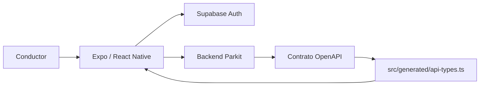
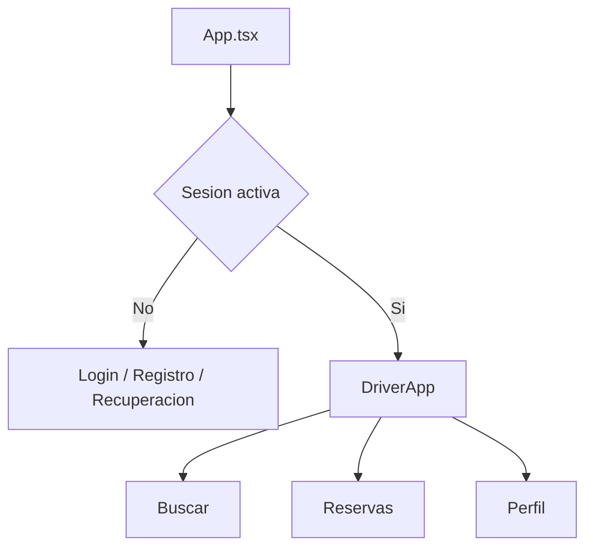
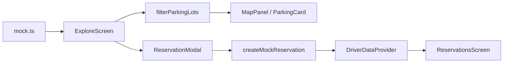

# Arquitectura actual de front-mobile

## Estado del documento

- Rama base analizada: `develop`.
- Commit base: `5d2537b` (`Merge pull request #3`).
- Alcance: arquitectura mobile posterior al login y sus dependencias compartidas.
- Este documento describe lo que existe. No representa todavía la arquitectura
  objetivo del mapa real.

## Contexto

`front-mobile` es una aplicacion Expo con React Native y TypeScript. Comparte con
los demas frontends el contrato HTTP generado desde OpenAPI y utiliza Supabase
para mantener la sesion del usuario.



La autenticacion ya se comunica con servicios reales. La experiencia de
conductor introducida en el PR 3 utiliza datos locales y no consulta endpoints
de estacionamientos o reservas.

## Stack vigente

| Area              | Implementacion                               |
| ----------------- | -------------------------------------------- |
| Runtime           | Expo 52, React Native 0.76 y React 18        |
| Lenguaje          | TypeScript en modo `strict`                  |
| Navegacion        | React Navigation 7 con bottom tabs           |
| Autenticacion     | Supabase JS y deep links de Expo             |
| HTTP              | Cliente `fetch` propio con contratos OpenAPI |
| Estado compartido | React Context y hooks                        |
| UI                | Componentes React Native y `StyleSheet`      |
| Graficos          | `react-native-svg`                           |
| Pruebas           | Vitest para logica pura                      |

## Arranque y sesion

`App.tsx` actua como composition root:

1. Inicializa `SafeAreaProvider` y `ToastProvider`.
2. Hidrata la sesion desde un deep link cuando corresponde.
3. Obtiene y observa cambios de sesion mediante Supabase.
4. Renderiza el flujo de autenticacion o `DriverApp`.

La navegacion autenticada vive en `src/features/driver/DriverApp.tsx`. El usuario
dispone de tres tabs tipados: `Explore`, `Reservations` y `Profile`.



Actualmente no existe un stack de navegacion dentro de `Explore`; busqueda,
mapa, seleccion y reserva se resuelven en una sola pantalla y mediante modales.

## Organizacion por features

El codigo sigue una organizacion feature-first:

```text
src/
  features/
    auth/
    driver/
      components/
      hooks/
      screens/
      createReservation.ts
      mock.ts
      navigation.ts
      selectors.ts
      theme.ts
  generated/
    api-types.ts
  lib/
    api/
    notifications/
    supabase/
```

Los componentes, estado y logica del conductor estan agrupados dentro de su
feature. `App.tsx` conserva responsabilidades de bootstrap y seleccion del flujo
autenticado, de acuerdo con las reglas del repositorio.

## Flujo de datos del conductor

`DriverDataProvider` mantiene reservas en memoria y expone una operacion para
crear una reserva mock. `ExploreScreen` conserva localmente la consulta, el tipo
de vehiculo, el filtro de reserva y el estacionamiento seleccionado.



Esta separacion permite probar filtros y construccion de reservas sin renderizar
componentes. Sin embargo, los tipos `ParkingLot` y `Booking` siguen perteneciendo
al archivo de mocks y hoy funcionan simultaneamente como entidades, DTOs y view
models.

## Patrones implementados

### Arquitectura

- **Feature-first:** autenticacion y conductor mantienen codigo y decisiones
  locales dentro de `src/features`.
- **Composition root:** providers y seleccion del flujo principal se ensamblan
  en `App.tsx` y `DriverApp.tsx`.
- **Context Provider:** las reservas mock se comparten entre tabs sin prop
  drilling.
- **Funciones puras:** filtros y creacion de reservas estan separados de React.
- **Contratos generados:** los DTO HTTP provienen de
  `src/generated/api-types.ts`; no se duplican manualmente.
- **Gateway HTTP comun:** `apiRequest` concentra URL base, headers, parseo y
  errores HTTP.
- **Traduccion centralizada de errores:** los errores visibles se transforman en
  `src/lib/api/translate.ts` o en los helpers de autenticacion.

### Diseno y experiencia

- **Tokens semanticos:** color, espaciado, radios y ancho maximo viven en
  `driver/theme.ts` y siguen `SHARED_STYLE_GUIDE.md`.
- **Component composition:** cards, modales, iconos y mapa mock estan extraidos
  de las pantallas.
- **Safe areas:** las pantallas ajustan contenido segun el dispositivo.
- **Responsive acotado:** el contenido utiliza ancho completo con un maximo de
  560 px.
- **Accesibilidad inicial:** controles interactivos declaran roles, labels,
  estados seleccionados, deshabilitados u ocupados.
- **Estados basicos:** las listas contemplan resultados vacios y las acciones
  muestran feedback mediante toasts.

## Implementacion actual del mapa y buscador

`MapPanel` no utiliza un proveedor geografico. Renderiza un dibujo SVG estatico
y posiciona pins con porcentajes incluidos en cada mock (`mapPosition`). No
existen camara, gestos geograficos, GPS, coordenadas ni calculos de distancia.

El buscador actual filtra `PARKING_LOTS` en memoria por nombre, direccion o
servicios. Normaliza mayusculas y tildes, pero no busca destinos, direcciones o
lugares reales.

## Limites relevantes para la siguiente iteracion

1. No estan instalados `react-native-maps` ni `expo-location`.
2. No hay navegacion entre los estados Home, busqueda y resultados en mapa.
3. No existen services de estacionamientos o reservas dentro de la feature.
4. Los estacionamientos mock no tienen latitud o longitud reales.
5. El mapa y la lista forman parte de un `FlatList` vertical; no existe una
   superficie map-first ni un bottom sheet.
6. La disponibilidad, distancia, precio y horario son strings o valores mock.
7. Las reservas solo viven en memoria y se pierden al cerrar la aplicacion.
8. No existe una capa de server state para cache, reintentos o cancelacion de
   solicitudes concurrentes.
9. La cobertura automatizada valida logica pura, pero no navegacion,
   accesibilidad renderizada, permisos, red o integracion en dispositivo.
10. La configuracion Expo define Android como `com.iankvdh.frontmobile` y no
    declara todavia un bundle identifier de iOS definitivo.

## Restricciones que se deben conservar

- Mantener `App.tsx` como bootstrap simple.
- Ubicar UI, hooks y servicios nuevos dentro de la feature correspondiente.
- Consumir DTOs generados desde OpenAPI cuando exista contrato backend.
- No editar `src/generated/api-types.ts` manualmente.
- No exponer mensajes crudos del backend al usuario.
- Mantener compatibilidad nativa y evitar APIs exclusivamente web.
- Preservar tokens y reglas de `SHARED_STYLE_GUIDE.md` o coordinar cualquier
  cambio entre los tres frontends.
