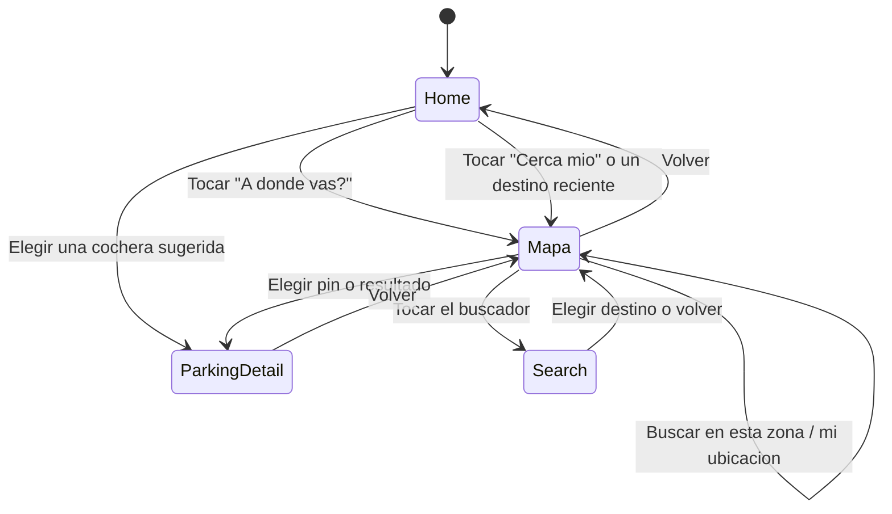
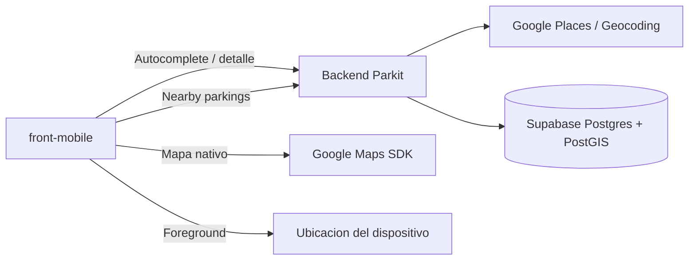

# Descubrimiento de estacionamientos: decisiones para el MVP

## Estado

- Estado: arquitectura y experiencia base implementadas en
  `feat/mobile-map-discovery`.
- Publico objetivo: conductores que estacionan en CABA.
- Prioridad del producto: el descubrimiento mediante busqueda y mapa es el
  flujo principal del MVP.

La rama valida el recorrido completo con destinos y estacionamientos mock. La
integracion con Google Places, el endpoint geografico de estacionamientos y la
telemetria quedan explicitamente fuera de este primer incremento hasta que
existan sus contratos y credenciales de desarrollo.

## Objetivo

Permitir que un conductor indique un destino o use su ubicacion, encuentre
estacionamientos Parkit cercanos con informacion util y seleccione uno con
confianza.

El principio de experiencia es:

> Primero decime adonde vas; despues te muestro donde conviene estacionar.

## Decisiones

| Tema                | Decision                                                     |
| ------------------- | ------------------------------------------------------------ |
| Cobertura           | Restringir descubrimiento y sugerencias a CABA               |
| Plataformas         | Android e iOS; sin paridad web del mapa en el MVP            |
| Prioridad de QA     | Android como plataforma principal de validacion              |
| Entrada principal   | Buscar un destino, direccion o lugar                         |
| Entrada alternativa | Buscar estacionamientos cerca de la ubicacion actual         |
| Mapa                | Se abre al tocar el buscador del inicio, sin exigir destino  |
| Proveedor           | Google Maps en Android e iOS                                 |
| Autocomplete        | Google Places API (New), restringida y sesgada a CABA        |
| Resultados          | Mostrar exclusivamente estacionamientos operados por Parkit  |
| Ubicacion           | Solicitar solamente permiso foreground y de forma contextual |
| Disponibilidad      | Informar disponibilidad actual, no prometer cupo futuro      |
| Indicaciones        | Delegar navegacion a Google Maps o Apple Maps                |
| Persistencia geo    | PostGIS con `geography(Point, 4326)` e indice espacial       |

## Flujo de experiencia



### Estado 1: Home

- Buscador `¿A donde vas?` como accion visual principal: abre el mapa.
- Acceso `Estacionar cerca mio`.
- Destinos recientes cuando existan.
- Hasta tres cocheras sugeridas: las mas cercanas al conductor si ya dio
  permiso de ubicacion, o las del centro de CABA si no.
- No solicitar permiso de ubicacion al iniciar la app.
- No renderizar un mapa interactivo detras del contenido.

### Estado 2: Mapa

Tocar el buscador del inicio abre el mapa sin exigir un destino
(`MapResultsScreen`; el destino es un parametro opcional).

- Mapa a pantalla completa con las cocheras Parkit de la zona.
- Buscador `¿A donde vas?` flotando arriba; con un destino elegido muestra su
  nombre. Tocarlo abre la pantalla de busqueda.
- Hoja inferior con la cochera mas cercana y el resto de los resultados.
- Boton de ubicacion sobre la hoja: centra el mapa en el conductor y es el
  unico punto donde el mapa pide el permiso.
- Sin destino el mapa arranca en el conductor si el permiso ya fue otorgado;
  si no, o si esta fuera de la cobertura, en el centro de CABA.

#### Cambio respecto de la primera version

En la primera version el buscador del inicio llevaba directo a la pantalla de
escribir, y el mapa aparecia recien despues de elegir un destino. Se cambio
porque la busqueda solo reconoce direcciones de CABA (no lugares como
"Monumental"): quien no conocia la direccion exacta no tenia como avanzar, y el
inicio no mostraba ninguna cochera. Ahora el mapa se abre primero, el conductor
puede moverse hasta la zona y usar `Buscar en esta zona`, y el inicio sugiere
cocheras sin necesidad de buscar.

### Estado 3: Busqueda

- Pantalla dedicada con autofocus y teclado abierto.
- Sugerencias de destinos de CABA con nombre y direccion secundaria.
- Minimo de tres caracteres y debounce inicial de 300 ms.
- Cancelacion o descarte de respuestas obsoletas.
- Estados explicitos de cargando, sin resultados y error recuperable.
- El mapa no compite visualmente con las sugerencias mientras se escribe.

### Estado 4: Mapa con un destino elegido

- Mapa como superficie principal, centrado en destino o ubicacion actual.
- Marcador distinto para destino y estacionamientos Parkit.
- Pins con precio desde o disponibilidad cuando el dato sea confiable.
- Bottom sheet sincronizado con el estacionamiento seleccionado.
- Filtros rapidos por vehiculo, disponibilidad actual y precio.
- Boton `Buscar en esta zona` despues de mover la camara.
- No consultar la API continuamente durante cada gesto del mapa.

## Alcance funcional

### Incluido

- Mapa nativo y ubicacion actual.
- Busqueda de direcciones, barrios y lugares dentro de CABA.
- Consulta de estacionamientos Parkit cercanos.
- Distancia, precio base y disponibilidad actual.
- Seleccion sincronizada entre pin y bottom sheet.
- Acceso al detalle del estacionamiento.
- Apertura de indicaciones en una aplicacion externa.
- Estados de permisos, carga, vacio, error y conectividad lenta.
- Eventos basicos de producto y rendimiento.

### Fuera del MVP

- Navegacion paso a paso dentro de Parkit.
- Trafico y rutas avanzadas.
- Busqueda nacional o cobertura AMBA.
- Garantia de disponibilidad futura por franja horaria.
- Multiples paradas, origen editable o flujo similar a un viaje.
- Casa y Trabajo como destinos persistentes.
- Clustering avanzado antes de que el volumen real lo justifique.
- Experiencia equivalente del mapa en web.

## Arquitectura objetivo de alto nivel



El backend actua como gateway de Places para proteger la credencial de web
services, aplicar limites, observabilidad y devolver solo los campos necesarios.
Las credenciales nativas de Maps se separan por plataforma y ambiente.

## Contratos backend necesarios

### Persistencia

Cada estacionamiento debe almacenar como minimo:

- Punto geografico con SRID 4326.
- Direccion canonica visible al conductor.
- Fecha y proveedor de geocodificacion.
- Mecanismo de correccion manual del pin.

La geocodificacion ocurre al crear o modificar la direccion, nunca durante cada
render o busqueda del conductor. Los estacionamientos existentes requieren
backfill y revision manual antes de publicarse.

### Descubrimiento

Contrato orientativo, sujeto a OpenAPI:

```http
GET /driver/parkings?lat=-34.6037&lng=-58.3816&radiusMeters=3000&vehicleType=CAR
```

Respuesta publica minima:

```ts
type NearbyParking = {
  id: string;
  name: string;
  address: string;
  latitude: number;
  longitude: number;
  distanceMeters: number;
  availableSpots: number | null;
  priceFrom: number | null;
  supportedVehicleTypes: VehicleType[];
};
```

El endpoint debe limitar radio, cantidad de resultados y datos expuestos. Solo
debe devolver estacionamientos activos y visibles para conductores.

### Disponibilidad

Para el MVP, `availableSpots` representa disponibilidad observada ahora:

```text
capacidad operativa - vehiculos actualmente dentro
```

`null` significa que no existe un dato confiable. La interfaz no debe convertir
`null` en cero ni mostrar una promesa de disponibilidad futura. La reserva por
horario requiere un dominio de inventario y reservas separado.

## Credenciales y ambientes

Usar la organizacion y facturacion existentes de GCP, pero separar proyectos:

- `parkit-maps-dev`
- `parkit-maps-prod`

Antes de generar credenciales se deben definir identificadores definitivos:

```text
Android package: com.parkit.mobile
iOS bundle ID:   com.parkit.mobile
```

Crear credenciales independientes:

- Android: Maps SDK, restringida por package y certificado SHA-1.
- iOS: Maps SDK, restringida por bundle identifier.
- Backend: Places/Geocoding, guardada como secreto y restringida por API y por
  origen de red cuando la infraestructura lo permita.

Configurar billing, cuotas, presupuesto y alertas antes de una prueba publica.

## Calidad y observabilidad

### Criterios de aceptacion

- Una negativa al permiso no bloquea la busqueda manual.
- La ultima consulta siempre prevalece sobre respuestas anteriores.
- Mover el mapa no dispara solicitudes continuas.
- Un error de Places no elimina resultados Parkit ya visibles.
- Un error de estacionamientos permite reintentar sin perder el destino.
- Pin y resultado seleccionado permanecen sincronizados.
- Los textos y controles no quedan ocultos por teclado, notch o bottom sheet.
- El flujo es operable con lector de pantalla y targets tactiles adecuados.

### Validacion inicial

- Probar al menos 20 destinos representativos de CABA.
- Incluir calles con numeracion, barrios, hospitales, estadios y puntos de
  interes.
- Probar permiso concedido, rechazado y ubicacion no disponible.
- Probar red lenta, perdida de conectividad y respuesta vacia.
- Probar Android fisico de gama media y al menos un dispositivo iOS.
- Medir tiempo hasta mapa util, latencia de sugerencias y latencia de resultados.

### Eventos sugeridos

- `destination_search_started`
- `destination_selected`
- `near_me_selected`
- `parking_results_loaded`
- `search_area_requested`
- `parking_selected`
- `parking_detail_opened`
- `location_permission_result`
- `parking_search_failed`

No registrar texto libre de busqueda ni coordenadas precisas en analytics sin
una politica explicita de privacidad y retencion.

## Orden de implementacion

1. Completado: validar los tres estados de UX y sus transiciones.
2. Parcial: package Android y bundle ID iOS definidos; proyectos GCP
   pendientes.
3. Pendiente: probar calidad de Places con destinos representativos de CABA.
4. Pendiente: incorporar coordenadas e indice PostGIS en backend.
5. Pendiente: publicar el contrato de descubrimiento y sincronizar tipos
   OpenAPI.
6. Completado con adapters mock: implementar mapa, ubicacion y busqueda en
   mobile.
7. Pendiente: integrar disponibilidad actual del backend.
8. Pendiente: completar telemetria y pruebas en dispositivos reales.

## Referencias tecnicas

- [Expo MapView](https://docs.expo.dev/versions/latest/sdk/map-view/)
- [Expo Location](https://docs.expo.dev/versions/latest/sdk/location/)
- [Google Places Autocomplete](https://developers.google.com/maps/documentation/places/web-service/place-autocomplete)
- [Google Maps API security](https://developers.google.com/maps/api-security-best-practices)
- [Google Maps pricing](https://developers.google.com/maps/billing-and-pricing/pricing)
- [Supabase PostGIS](https://supabase.com/docs/guides/database/extensions/postgis)
